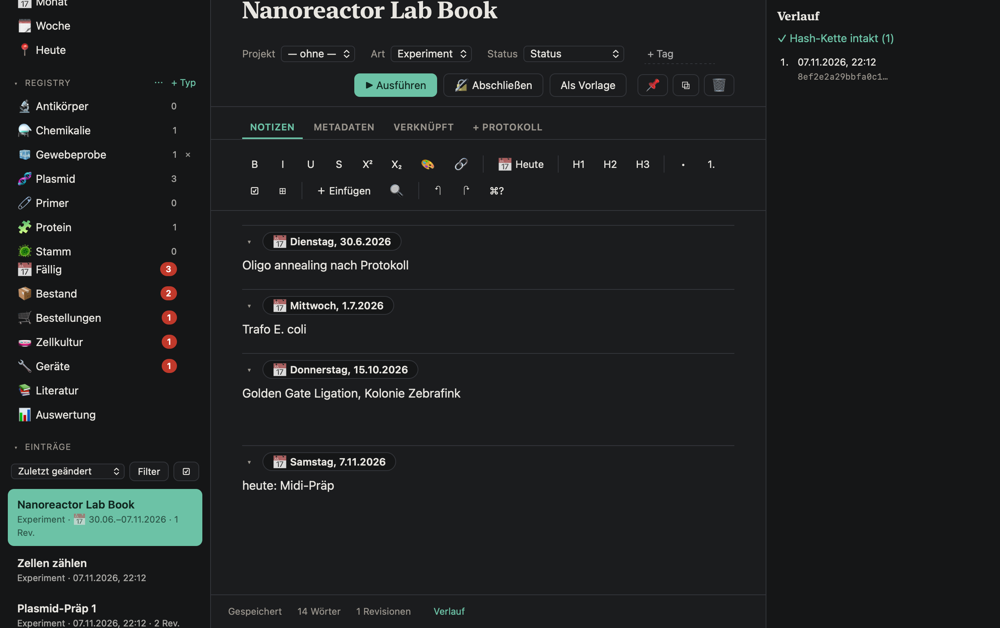
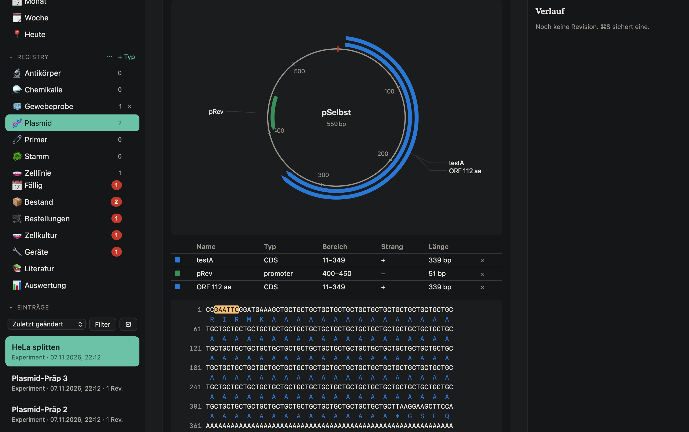
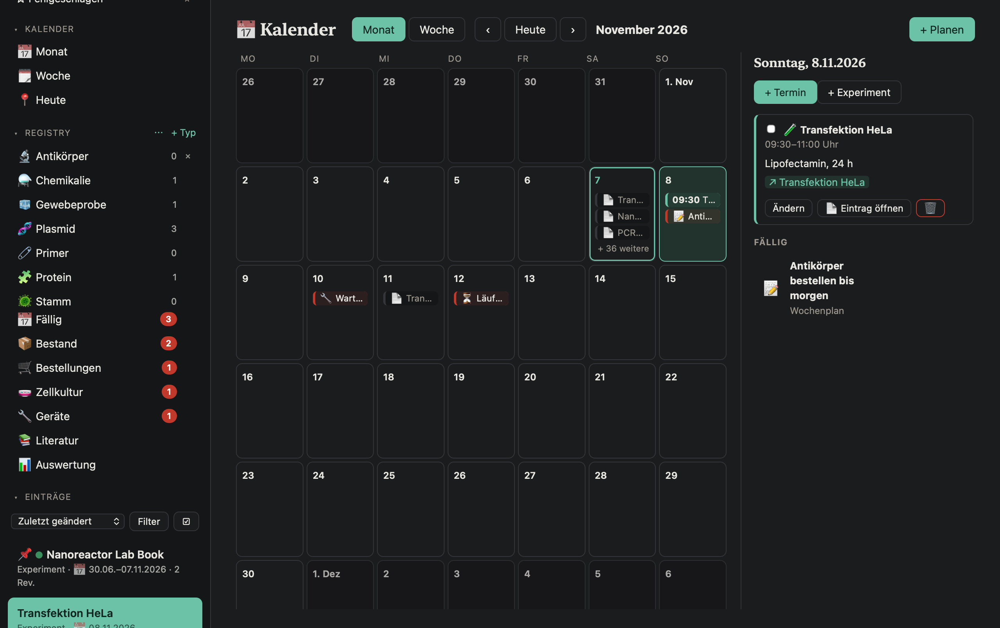

# BioBook

**A fast, local electronic lab notebook for the Mac.** One file you own, works fully offline, instant search, immutable history with signatures, and a lot of molecular-biology tooling built in.

[](LICENSE)




<p align="center">
  
  
</p>

> The screenshots show the German interface with synthetic test data. **BioBook is available in German and English:** choose *Settings (⌘,) › Language* ("Automatisch / Automatic" follows the system language, German on German systems and English otherwise). See [Interface language](#interface-language) for what is and is not translated.

## Why BioBook

- **Your data stays yours.** A notebook is a single folder package (`Name.biobook`: SQLite plus attached files). Everything is stored locally. There is no account, no server and no sync service.
- **Nothing is silently overwritten.** Every saved state is an immutable revision linked by a hash chain. Finished entries are signed with your personal Ed25519 key and become read-only; later additions go into an addendum.
- **Built for the bench.** Calculators, plate layouts, sequence maps, cloning simulation, inventory, cell culture and equipment logs sit next to the free-text notes.
- **Fast.** Native macOS shell (Swift, WebKit) with a block editor (TipTap). Full-text search over 10,000 entries answers in milliseconds.

## Features

**Notes and editor**
- Block editor: headings, lists, checklists, tables, code, quotes, images and files by drag and drop, formulas in LaTeX, sub- and superscript, text colour and highlighting, find and replace, a `/` command menu and `[[` links between entries (with back-links).
- Running lab book: day sections ("Tuesday, 30.6.2026") that can be collapsed, a "Today" shortcut and a period shown in the list.
- Entry kinds (experiment, note, protocol), status (running, done, failed, paused), tags, projects, pinning, duplication, saved searches, bulk actions and a trash with restore.
- Tabs and multiple windows, several notebooks, Spotlight and Quick Look support.
- Interface in German and English, switchable in the settings.

**Records you can trust**
- Immutable revisions with a verified hash chain; compare any old revision with the current state.
- Finish and sign an entry with a personal key stored in the macOS Keychain. Optional witness PDF (hash in text and metadata, fields for name, date and signature).
- Local accounts, lock with Touch ID or password, automatic daily backups (last 14 are kept).
- Signatures and timestamps are evidence, **not** a certification under GLP or 21 CFR Part 11.

**Lab management**
- **Registry:** typed objects (plasmid, primer, strain, cell line, antibody, chemical, or your own types and fields) with sequential IDs like `PL-0042` and a full history. Mention them in notes with `@`.
- **Inventory:** locations as a tree (room, device, shelf, box with grid), lots with amount, unit, expiry and minimum stock, GHS hazards and safety data sheets. Every change is an immutable booking.
- **Orders:** reorder suggestions, order list with status history, goods receipt that creates new lots.
- **Cell culture:** cultures, passages, medium changes, mycoplasma tests, freezing and thawing.
- **Equipment log:** recurring maintenance and calibration tasks with due dates.
- **Labels:** QR code labels (A4 sheets) for lots, objects, locations, cultures and devices; scan with the camera, a handheld scanner or a link.
- **Calendar and due items:** plan appointments and experiments, see due checklist items, equipment tasks and expiring lots in one place, export as `.ics`.

**Calculations, analysis and molecular biology**
- Calculators: dilution (C1·V1 = C2·V2), weighing, master mix, unit conversion. Structured result tables with computed fields, evaluation across entries with charts and CSV export.
- Standard curves, group comparisons with t-tests (Welch, Student, paired; p-values checked against SciPy) and charts.
- Sequences from GenBank or FASTA: circular and linear maps, features, translation, ORF finder, motif search, restriction enzymes and virtual digest, primer Tm (nearest-neighbour, matches Primer3), Sanger `.ab1` alignment with chromatogram, and simulated cloning (restriction/ligation, Gibson, Golden Gate).
- Chemistry: SMILES structure drawing, molecular formula and molar mass.
- Plate layouts (96 and 384 wells), plate reader, NanoDrop and qPCR file import.
- References: import from DOI (Crossref) or PMID (PubMed), BibTeX, RIS and CSL-JSON, optional Zotero connection, citations with an automatic reference list.

**Import, export and automation**
- Export as a folder readable without the app (HTML, Markdown, all attachments, `book.json`) and as `.eln` (RO-Crate). Import `.eln`, Markdown, Word/RTF/ODT, HTML, scanned PDFs and images.
- Text in images and scanned PDFs is recognised locally (Apple Vision) and searchable.
- AppleScript, Shortcuts and a Services menu entry (see [below](#automation)).
- Sandboxed extensions: custom calculators as small `.js` files that run without network or file access.
- **Optional AI assistant** (summaries, protocol drafts, questions about your notes). It is off by default, needs your own Anthropic API key, shows exactly what will be sent before each request and marks every result as "please check".

## Install

1. Download `BioBook-AppleSilicon.dmg` from the [latest release](https://github.com/Fese1000/BioBook/releases/latest).
2. Open it and drag **BioBook** to your Applications folder.
3. The app is only ad-hoc signed (it is not notarised). On first launch macOS asks for confirmation: on macOS 15, open the app once, then go to *System Settings › Privacy & Security › Open Anyway*; on macOS 13/14, right-click the app and choose *Open*.

Requirements: macOS 13 or later, Apple Silicon. Intel builds are prepared (`./make-app.sh x86_64`) but not released.

**Updates:** *Settings (⌘,) › Check for updates*. The app downloads the DMG of the newest release from GitHub, verifies its SHA-256 checksum, bundle ID, version and signature, replaces itself and restarts. On any error the old version stays.

## Your data

- A notebook is a package folder `Name.biobook` (SQLite plus `files/`). The default notebook lives in `~/Library/Application Support/BioBook/Standard.biobook/`.
- Notes, search and all tools work fully offline. The app contacts the network in three cases: when you click something that needs it (fetching a sequence or reference from NCBI, UniProt, Crossref or PubMed, or a request to the optional AI assistant), and for a quiet **update check** at startup and every six hours. A failed or empty check shows nothing. You can switch the update check off in *Settings (⌘,)*.
- Your signing key and the optional Anthropic key are stored in the macOS Keychain; a notebook contains only the public key. Because the app is ad-hoc signed, macOS asks for your login password once after an update before the new version may use the key (choose "Always Allow").
- Errors are logged to `~/Library/Logs/BioBook/app.log` (without entry contents).
- **Backups:** one copy of the database per day (the last 14 are kept) plus new attachments, by default in `~/Library/Application Support/BioBook/Sicherungen/`. You can choose another folder (for example an external drive) in the settings. To restore, quit the app, copy the wanted `db-….sqlite` as `db.sqlite` together with `files/` and `meta.json` into a folder named `Name.biobook`, and open it.
- Older notebooks are upgraded automatically when opened (a copy of the database is saved to `backups/` first). Notebooks from a newer app version are never touched.

### Coming from "Laborbuch"

BioBook was called *Laborbuch* until November 2026. On first launch the app **copies** `~/Library/Application Support/Laborbuch` to `BioBook` (the default notebook becomes `Standard.biobook`) and takes over the settings of the old bundle ID `de.felix.laborbuch`. The signing key and the Anthropic key are taken over from the old Keychain items on first use (macOS asks once for your password). Nothing is deleted, the old data stays as a fallback. Notebooks ending in `.laborbuch` and links starting with `laborbuch://` keep working; new notebooks use `.biobook` and `biobook://`. The format identifiers `laborbuch-signatur-v1` (signatures) and `laborbuch-export-1` (export) are intentionally unchanged, otherwise existing signatures could no longer be verified.

## Interface language

*Settings (⌘,) › Language* offers **Automatic**, **Deutsch** and **English**. Switching reloads the windows; menus and system dialogs change immediately.

German is the source language of the code; English comes from the dictionary `web/lang/en.json` (German text → English text), which is shared by the web interface and the native menus and dialogs. What is **not** translated:

- Everything you write yourself: entry text, titles, names of registry objects and so on. Day section headings ("Tuesday, …") and dates follow the language.
- The machine-readable header keys of the Markdown export (`titel:`, `art:` …) and the folder names `Sicherungen` (backups) and `Erweiterungen` (extensions) in the data folder.
- Number formats in calculators and results (decimal comma is accepted and shown).
- Some rarely seen messages may still appear in German. The English texts were checked against the app's own self-test (which reports every text without an English counterpart), but not by a native speaker. Corrections are welcome, see [CONTRIBUTING.md](CONTRIBUTING.md).

## Automation

- **URL scheme** (usable in the Shortcuts app with "Open URL"): `biobook://new?title=…&text=…`, `biobook://append?id=…&text=…` (asks for confirmation) and `biobook://search?q=…`.
- **AppleScript:**
  ```applescript
  tell application "BioBook" to create entry titled "PCR" with text "…"
  tell application "BioBook" to find entries "Taq"
  ```
  Also `append text "…" to entry 12` and `entry text 12`.
- **Services menu:** *New BioBook entry* turns selected text from any app into an entry. Finished entries stay unchanged.

## Build from source

Requires the Xcode Command Line Tools.

```bash
./make-app.sh arm64 --no-dmg   # app only: build/AppleSilicon/BioBook.app
./make-app.sh arm64            # also creates dist/BioBook-AppleSilicon.dmg
```

The editor is bundled in `web/vendor/tiptap.js`. Rebuild it only when updating dependencies: `cd tools && npm install && npm run bundle`.

### Tests

```bash
# Swift: storage, hash chain, search, templates, runs, migration
swiftc app/Store.swift app/Registry.swift app/Stock.swift app/Results.swift app/Culture.swift app/Orders.swift \
  app/Sequences.swift app/References.swift app/Agenda.swift app/AutomationStore.swift app/EntryExtras.swift \
  app/EntryManage.swift app/Account.swift app/Planner.swift app/Prefs.swift app/Migration.swift app/Localization.swift tests/main.swift \
  -o /tmp/biobook-tests && /tmp/biobook-tests

# JavaScript: calculators, sequences, statistics, import/export formats, ...
node --test tests/*.test.js

# End-to-end in the real WebView (uses temporary data and a key file, never your Keychain)
BIOBOOK_BOOK=/tmp/self.biobook BIOBOOK_KEYFILE=/tmp/self.key BIOBOOK_TESTOUT=/tmp BIOBOOK_BACKUPDIR=/tmp/backup \
  build/AppleSilicon/BioBook.app/Contents/MacOS/BioBook --selftest
```

Numerical code is checked against reference implementations where possible (Primer3 for melting temperatures, SciPy for statistics, Biopython for `.ab1` files, NCBI record L09137 for pUC19).

## Project layout

| Path | Purpose |
| --- | --- |
| `app/` | Swift: window and WebView shell (`main.swift`), SQLite store with hash-chained revisions (`Store.swift`), registry, inventory, cell culture, orders, keys and signatures, backup, updater, migration, AppleScript |
| `web/` | The user interface and logic in JavaScript (editor, calculators, sequence tools, statistics, import/export); `web/i18n.js` and `web/lang/en.json` are the language layer |
| `web/vendor/` | Bundled third-party code (see [THIRD_PARTY_NOTICES.md](THIRD_PARTY_NOTICES.md)) |
| `tests/` | Swift storage tests, JavaScript unit tests, fixtures |
| `tools/` | Editor bundling and icon generation |
| `BAUPLAN.md` | Milestone plan and project history (German) |

## Status and limitations

- The interface exists in German and English only; see [Interface language](#interface-language) for the limits.
- macOS on Apple Silicon only; the app is ad-hoc signed and not notarised.
- Signatures and timestamps are evidence, not a certification under GLP or 21 CFR Part 11.
- Single user, local only. Team sync and roles are not planned for now.
- Please try new versions with a copy of your data and keep your own backups.

## Contributing

Bug reports, ideas and pull requests are welcome. Please read [CONTRIBUTING.md](CONTRIBUTING.md) and the [Code of Conduct](CODE_OF_CONDUCT.md). For security issues see [SECURITY.md](SECURITY.md).

## License

[MIT](LICENSE) © 2026 Felix Cuntz. Bundled third-party code keeps its own licenses, see [THIRD_PARTY_NOTICES.md](THIRD_PARTY_NOTICES.md).
